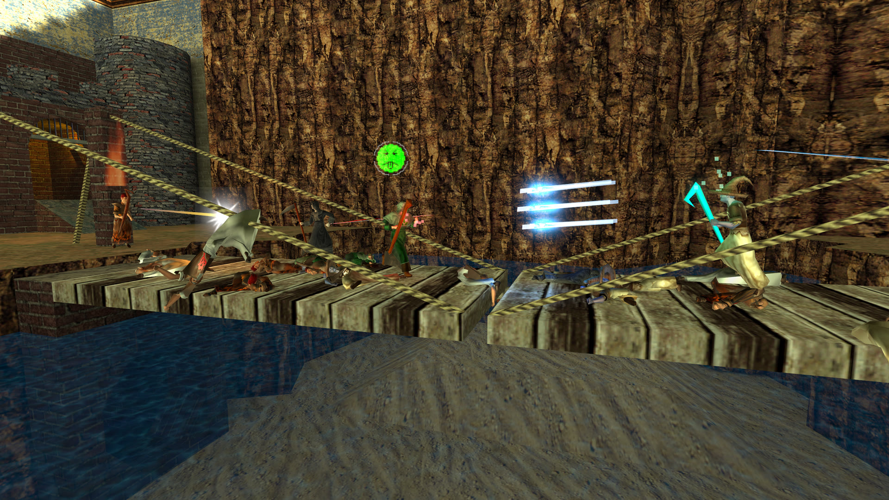
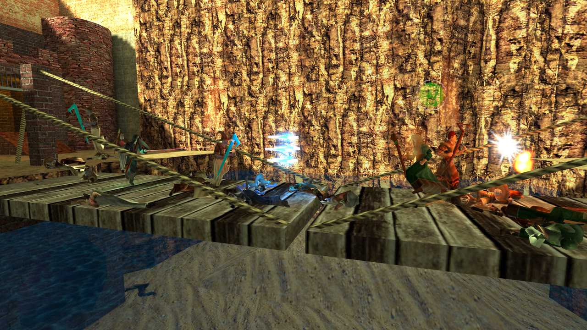
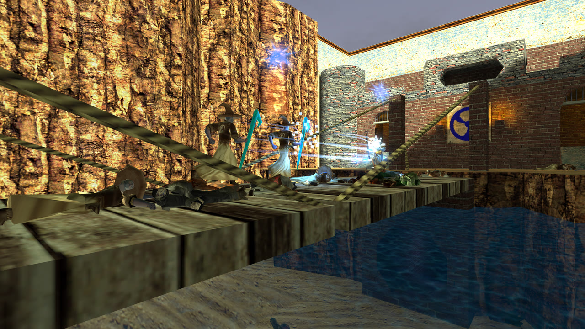

# Wizard Wars

Team-based wizard combat, ported from the Half-Life mod of the same name to Godot 4. Nine
wizard classes (fire, ice, lightning, earth, wind, nature, life, death and the archmage) fight
over flags, control points and siege objectives on the original mod's maps, with bots to fill
the teams. It runs on macOS, Windows, Linux and Meta Quest (VR).



<p>
  
  
</p>

## How to play

- [The Wizards](docs/wizards.md): every class, its spells, satchel and tips.
- [Combo Spells](docs/combo_spells.md): the eight two-element spells, and how to earn one by
  clashing staves with a teammate.

## Libraries

The engine-side work lives in four GDExtensions, each its own MIT-licensed repo, pulled in as
submodules under `extern/` and linked into `addons/`:

| Library | What it does |
|---|---|
| [goldsrc-godot](https://github.com/alanfischer/goldsrc-godot) | Loads GoldSrc assets: BSP maps (lightmaps, clip hulls, entities), MDL models, SPR sprites, WAD textures |
| [hop-godot](https://github.com/alanfischer/hop-godot) | The [hop](https://github.com/alanfischer/hop) physics engine as Godot's `PhysicsServer3D`, with exact BSP hull traces |
| [goldnet-godot](https://github.com/alanfischer/goldnet-godot) | GoldSrc/Quake-style netcode as a drop-in `MultiplayerAPI`: delta snapshots against acked baselines, input as a command stream. Core protocol in [goldnet](https://github.com/alanfischer/goldnet) |
| [pmove-godot](https://github.com/alanfischer/pmove-godot) | GoldSrc player movement plus client-side prediction (GDScript) |

Vendored in `addons/`:

- [TwoVoIP](https://github.com/goatchurchprime/two-voip-godot-4) (MIT): voice chat, Opus + RNNoise. See [Voice chat](#voice-chat).
- [Godot OpenXR Vendors](https://github.com/GodotVR/godot_openxr_vendors) 5.1.0 (MIT): Quest and other headsets.

## Getting started

You need **Godot 4.7** (the standard build, not .NET), plus **git**, **cmake** and
**[zig](https://ziglang.org)** to compile the extensions (zig is the cross-compiler for every
platform; `brew install cmake zig` on macOS).

```bash
git clone --recursive https://github.com/alanfischer/wizardwars
cd wizardwars
./build_extension.sh macos       # or linux / windows; no argument builds every platform
```

Open the project in the Godot editor once so it imports the assets and registers the
`class_name`s, then press Play. The lobby can host a game or join one by address.

The scripts look for Godot at `/Applications/Godot.app` or `~/Applications/Godot.app`; set
`GODOT=/path/to/godot` anywhere else (Linux, Windows, a pinned engine).

### Playing from source

```bash
./run.sh --map ww_hunt                                      # dedicated server (UDP 9050, HTTP 8080)
"$GODOT" --path . -- --connect 127.0.0.1 --name Alan        # a client that joins it
"$GODOT" --path . -- --host --map ww_2fort --bots 4         # listen server: host and play in one process
```

Game flags go after the `--`. The useful ones: `--map`, `--bots <n>`, `--botskill`, `--name`,
`--team`, `--class`, `--timelimit`, `--scorelimit`, `--fraglimit`, `--mapcycle <file>`,
`--admin-password`, `--bsp-hulls on|off`, and `--stock` to fall back from goldnet to Godot's
own `SceneMultiplayer` (both ends must agree). `src/main.gd`'s `_flag_handlers()` is the full
list, and a mistyped flag is reported rather than ignored.

Maps convert from `.bsp` to a cached `.scn` the first time they load; `./convert.sh` does all
of them ahead of time. The cache is keyed on `CACHE_VERSION` in `src/systems/map_converter.gd`
(and `MDL_CACHE_VERSION` in `resource_converter.gd` for models) — bump it when a change alters
what conversion produces, or stale caches win. `./clean_cache.sh` wipes them.

### Maps

The rotation is the nine maps in `maps/mapcycle.txt`: ww_2fort, ww_ravine, ww_storm, ww_hunt,
ww_chasm, ww_roc2, ww_wstland4, ww_golem and ww_monoliths. The other `.bsp`s in `maps/` load and
can be played (`--map`, `/map`), but releases ship only the rotation unless built with
`--all-maps`. Bot navigation is baked per map into `maps/waypoints/` (`tools/bake_waypoints.sh`).

### VR

`./deploy_quest.sh` builds an APK and installs it on a Quest over ADB (developer mode on, USB
connected). It needs the Android export templates and SDK set up in the editor.

## Repository layout

| Path | Contents |
|---|---|
| `src/` | The game. `main.gd` is the entry point; `systems/` holds the autoloads (networking, goals, spawning, sound, bots…), `wizards/` the classes, `weapons/`, `projectiles/`, `entities/` (GoldSrc entity behaviours), `bot/`, `tests/` |
| `extern/` | The four library submodules |
| `addons/` | Godot plugins: symlinks into `extern/`, plus TwoVoIP and OpenXR |
| `maps/`, `models/`, `sounds/`, `sprites/`, `sky/`, `*.wad` | Game assets in their GoldSrc formats |
| `tools/` | Asset tools (`mdl.py`, `spr.py`, `wad.py`, `bsp.py`), the `*_art.py` generators that made the replacement art, one-off map patches (`ww_*.py`), `probe_*.gd` debug scenes, and the screenshot scenes behind the README (`readme_shots`) and the player docs (`doc_shots`) |
| `plans/`, `TODO.md` | Design notes and open work |

The Python tools need a venv with `numpy`, `scipy` and `pillow`; the sound generator also uses
`onnxruntime` and `kokoro-onnx`.

## Scripts

| Script | What it does |
|---|---|
| `build_extension.sh` | Build every GDExtension (`macos`, `linux`, `windows`, or all) |
| `run.sh` | Dedicated server from source |
| `run_tests.sh` | The test suite, headless |
| `convert.sh` | Convert GoldSrc assets (BSP/MDL/SPR/WAD) to Godot format |
| `clean_cache.sh` | Delete converted maps and resources so they rebuild |
| `deploy_quest.sh` | Build the Quest APK and install it over ADB |
| `build.sh` | Export client and/or server binaries |
| `package.sh` | Bundle converted assets into the Linux server package |
| `release.sh` | Full pipeline: convert → build → package → upload to the release server |
| `launcher.sh` | Player-facing (macOS/Linux): auto-updates and launches the game |
| `launcher.bat` | Player-facing (Windows): auto-updates and launches the game |

### build.sh flags

```
./build.sh                  macOS client (default)
./build.sh --windows        + Windows client
./build.sh --linux-client   + Linux client
./build.sh --linux-server   + Linux server binary
./build.sh --zip            Zip all outputs
```

## Doing a release (maintainers)

```bash
./release.sh                     # full release (converts assets, builds all, uploads, restarts server)
./release.sh --map ww_castle     # restart server on a specific map (default: ww_2fort)
./release.sh --no-restart        # upload without restarting the server
```

This converts assets, builds macOS/Windows/Linux clients and the Linux server, packages everything, rsyncs to the release server, and restarts the game server.

Where it ships comes from `release.env` in the project root, which is gitignored so the source never names the server:

```bash
WW_SERVER_HOST=game.example.com      # baked into the shipped launchers and the lobby's Address box
WW_REMOTE=user@game.example.com      # ssh/rsync target
WW_SSH_PORT=22
```

`build.sh` stamps `WW_SERVER_HOST` into the `.pck` as `default_server.txt` (like `build_id.txt`, never committed), and `release.sh` writes it into the copies of `launcher.sh`/`launcher.bat` it uploads. Builds made without it leave the Address box empty, and the source launchers ask for `WW_UPDATE_SERVER`.

## Running tests

```bash
# src/tests runs as a scene so the project's autoloads (GoalSystem, NetworkManager, …)
# are registered for the tests; a `-s` script main-loop skips autoload setup.
/Applications/Godot.app/Contents/MacOS/Godot --headless --path . res://src/tests/run_tests.tscn
```

Or set `GODOT` to override the binary path:

```bash
GODOT=/path/to/Godot ./run_tests.sh
```

Each `extern/*-godot` submodule is its own project and tests itself, so its suite runs in its
own repo (`extern/pmove-godot/run_tests.sh`, and likewise for hop, goldnet and goldsrc) rather
than on every WizardWars test pass.

## class_name and preload

Some scripts deliberately have no `class_name` and are reached with `preload` instead:

```gdscript
const GameVersion = preload("res://src/systems/game_version.gd")
```

A `class_name` only resolves once it is in Godot's global class cache (`.godot/global_script_class_cache.cfg`),
which only an editor run regenerates. Adding one therefore breaks every headless-from-source run —
the test suites, the server, CI — until somebody opens the editor, and the failure is a parse error
in whatever loaded the script, not in the script that named itself. Scripts that must load in those
runs take the `preload` instead; files saying "no `class_name`" point here.

## Match flow and map rotation

A match ends when a limit is reached, the final scoreboard goes up for a few seconds, and the
server loads the next map in the rotation. Everyone keeps the team and class they were playing,
and the bots come back — nobody is dropped into the team menu between maps.

The limits are server vars, so they can be set from the console or on the command line
(a dedicated server has no console). `0` turns any of them off:

```
/timelimit 20        # minutes; 0 = no clock
/scorelimit 5        # team points; 0 = off
/fraglimit 30        # one player's frags (kills + objective points); 0 = off
./run.sh --map ww_2fort --timelimit 20 --scorelimit 5
```

A time or score limit is won by a team; a frag limit is won by the player who reached it, and the
banner names them. The clock is on screen at the top, and turns red for the last minute.

The rotation is `maps/mapcycle.txt` — one map name per line, `#` starts a comment. Names that
aren't installed are skipped with a warning. A server operator can override it with a copy at
`user://mapcycle.txt`, or point at any file with `--mapcycle <path>`. With no cycle file at all
the rotation is every installed map, alphabetically.

```
/maplist             # the rotation, marking what's playing and what's next
/nextmap             # what loads after this match
/nextmap ww_hunt     # admin: jump the queue (/nextmap clear hands it back)
/timeleft
```

Between matches the next three maps in the rotation go to a vote — `/vote 1`, `/vote 2`, `/vote 3`,
one each and changeable while the intermission lasts. Most votes wins; a tie goes to the first
option, which is the map the rotation was going to play anyway, so an intermission nobody votes in
changes nothing. An admin who names the map with `/nextmap` takes the ballot down.

## BSP hull collision

World collision traces the map's GoldSrc BSP clip hulls (exact plane normals, real
18-unit steps) rather than the trimesh/convex colliders. It is **on by default** and
needs nothing enabled per map — but a map has to be converted with a current
goldsrc-godot for the clip hulls to be in its `.scn`, so run `./convert.sh` (or
`./release.sh`) after pulling an `extern/` bump.

Toggle it with the `bsp_hulls` server var, which replicates — the host decides what
everyone collides against, since a client disagreeing mispredicts every step:

```
/bsp_hulls off          # in-game console, admin only
./run.sh --bsp-hulls off --map ww_2fort    # dedicated server, which has no console
```

Turning it off falls back to the trimesh/convex colliders. Details of the metadata
contract and the engine-side toggle are in `extern/goldsrc-godot/README.md` and
`extern/hop-godot/README.md`.

## Voice chat

Push-to-talk on two keys: **V** talks to everyone, **B** to your own team (both
rebindable, under Talking). The channel is latched when a stream opens, so letting go
of one key and grabbing the other mid-sentence cannot redirect audio already in
flight. `/voice` reports the state and switches it off or changes the volume;
`/mute <player>` and `/unmute` last for the session.

The audio is [TwoVoIP](https://github.com/goatchurchprime/two-voip-godot-4) (MIT) —
Opus at 24 kbit/s, RNNoise and a per-speaker jitter buffer — vendored into
`addons/twovoip` by `tools/vendor_twovoip.sh`, which pins the release tag, prunes the
libs to the platforms we export, and quiets the helpers' per-stream `print`s. Run it
to move to a newer TwoVoIP. `libtwovoip` is optional the way `libgoldnet` is: a client
without it logs a line and plays on in silence.

Everything rides the **unreliable** channel, which is what TwoVoIP is built for — a
lost frame is a click, not retransmit pressure on the stream goldnet exists to keep
clear. One talker costs a listener about 2.5 KB/s. The server never decodes voice: it
relays bytes to the channel's listeners (`ServerRequests.voice`, on the same team test
chat uses) under a per-sender token bucket, so no client can push more voice at it
than it could be speaking.

Capture needs `audio/driver/enable_input` (set in `project.godot`), the macOS
`audio_input` entitlement and Android's `RECORD_AUDIO` — all three are in the export
presets. The microphone is only opened once you are a player in a live session, and
TwoVoIP asks Android for the permission at that point. Quest has no binding yet: the
two controls are keyboard actions, so voice there needs a button on the OpenXR action
map first.

## Testing locally (LAN)

```bash
./release.sh --serve      # builds clients and packages dist/; prints player instructions
```

Then start the game, host a server with:
```
--http-downloads-dir <path-to-dist/>
```

Players connect with:
```bash
WW_UPDATE_SERVER=http://<your-ip>:8080 ./launcher.sh
```

## Server-side setup (one time)

SSH into the release server and run the game server — it handles both game traffic (port 9050) and client downloads (port 8080) in one process:

```bash
cd ~/wizardwars/server
./run.sh --map <mapname>
```

Keep it alive with `screen` or `tmux`.

### Status endpoint

The same HTTP server answers `GET /status.json` with what is running right now — the build, map,
human and bot counts, names, and the match clock:

```bash
curl http://<server>:8080/status.json
{"game":"WizardWars","version":"1.0.0 (1ae53e54)","map":"ww_2fort","players":2,"bots":4,
 "max":8,"port":9050,"player_names":["Alan","Ben"],"bot_names":["BOT fire", ...],
 "time_left":1193,"intermission":false,"uptime":1408}
```

Refreshed once a second, so anything that polls HTTP (a server browser, Home Assistant's `rest`
sensor) can show whether the server is worth joining.

## Versioning

A build identifies itself as `1.0.0 (1ae53e54)` — a semantic version and the commit it was
exported from. It is the last line of the lobby menu and the `version` field of `/status.json`,
so a bug report can say what it came from.

The semantic version lives in **one** place, `application/config/version` in `project.godot`.
Bump it there, and match it in `export_presets.cfg` — the Windows `file_version`/`product_version`
and the Android `version/name`, which stamp the `.exe` and the manifest and cannot read the
project setting themselves.

The commit half is stamped by `build.sh` into `build_id.txt`, which is bundled into the `.pck`
(via each preset's `include_filter`) and is never committed. Running from source or in the editor
finds no stamp and reports `1.0.0 (dev)`; a build made with uncommitted changes is marked
`-dirty`, because the sha alone will not reproduce it.

This is separate from the launcher's own `version.txt` (`<sha>-<timestamp>`), which only decides
whether there is an update to download.

## Player setup

**macOS / Linux** — download the launcher once; it auto-updates on each launch:

```bash
curl -fO http://<server>:8080/launcher.sh
chmod +x launcher.sh
./launcher.sh
```

**Windows** — download `launcher.bat` from `http://<server>:8080/launcher.bat` and run it.
