# The Wizards

Eight wizard classes fight in every match, and a ninth, the Archmage, turns up only on maps
built around protecting one. Each class has a staff, three or four spells and a satchel. Two
allied wizards of the right elements can also clash their staves together to earn a
[combo spell](combo_spells.md).

The flavour text below comes from the original mod's class descriptions, as are most of the
tips. Their numbers don't: they're taken from this port's code.

- [The basics](#the-basics)
- [Pyromancer (fire)](#pyromancer-fire)
- [Cryomancer (ice)](#cryomancer-ice)
- [Fulgomancer (lightning)](#fulgomancer-lightning)
- [Geomancer (earth)](#geomancer-earth)
- [Aeromancer (wind)](#aeromancer-wind)
- [Phytomancer (nature)](#phytomancer-nature)
- [Sanomancer (life)](#sanomancer-life)
- [Necromancer (death)](#necromancer-death)
- [Archmage](#archmage)

## The basics

**Mana.** Every wizard has 100 mana and starts each life with a full bar. Mana does **not**
come back on its own. Walk over the mana packs and backpacks around the map to refill it.
Some spells cost mana once per cast. Others, like the rays, levitation and invisibility, also
drain it every second you hold them.

**Casting.** Primary fire casts the spell in your hands; hold it for the spells that stream
or charge. Secondary fire is a spell's other mode, when it has one. The number keys pick a
spell, and the slot numbers in the tables below match the keys.

**The staff.** Slot 1 is always your staff: a melee swing for 30 that costs nothing and
swings twice a second. It's your fallback when the mana runs out, and it's also how
[combo spells](combo_spells.md) are earned.

**Satchels.** You carry three, refilled every time you respawn. Hold the satchel key to light
the fuse and release to throw. The 3-second fuse burns while you hold it, so a quick tap lobs
a bomb downrange and a long hold drops one at your feet. Hold it too long and it goes off in
your hand. Each element's satchel does something different, listed under each class.

**Status effects.**

| Status | Caused by | Effect |
|---|---|---|
| Burning | fire damage | 2 damage per second for 5 seconds |
| Poisoned | death damage | 2 damage per second until you're healed |
| Frosted | ice damage | Your footing turns to ice: you slide, and can barely stop or turn. Each hit adds a second, up to 4 |

Any healing cures all three: a Sanomancer's ray or satchel, a wombat, a health pack.

**Speed and health at a glance.**

| Class | Health | Speed |
|---|---|---|
| Sanomancer (life) | 75 | Fastest |
| Aeromancer (wind) | 80 | Fastest |
| Cryomancer (ice) | 90 | Fast |
| Phytomancer (nature) | 90 | Fast |
| Fulgomancer (lightning) | 80 | Medium |
| Pyromancer (fire) | 100 | Slow |
| Geomancer (earth) | 100 (200 as a bear) | Slow (slowest as a bear) |
| Necromancer (death) | 120 | Slow |
| Archmage | 60 | Slowest |

---

## Pyromancer (fire)

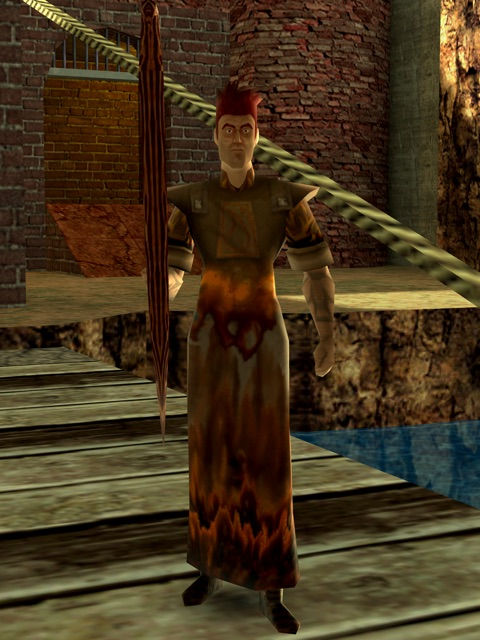

> *Evoker of the Arcane Flame, the Pyromancer utilizes the unchecked powers of fire to turn
> those before him to ash and smoke. There are few able, or willing, to stand against a
> Pyromancer in a Wizard's Duel, for there are none as destructive.*

**Health** 100 · **Speed** slow

| Slot | Spell | Mana | What it does |
|---|---|---|---|
| 1 | Pyro Staff | — | Melee swing, 30 damage. |
| 2 | Magic Missile | 5 | A straight bolt for 15. Hold to keep firing. |
| 3 | Flame Lick | 5 | An instant burst of flame where you aim: 15 to everything within 3 m of the impact, setting it alight. Twice a second. |
| 4 | Fireball | 20 | A fireball that bursts for 40 within 4 m, knocks wizards back and sets them burning. |
| 5 | Reality Fissure | 90 | Pins you in place for 3 seconds while a tear in reality opens in front of you, then detonates for 500 within 3 m. It also blows open walls that a map marks for demolition. |

| 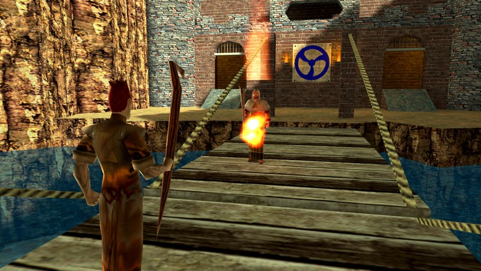 **Flame Lick** | 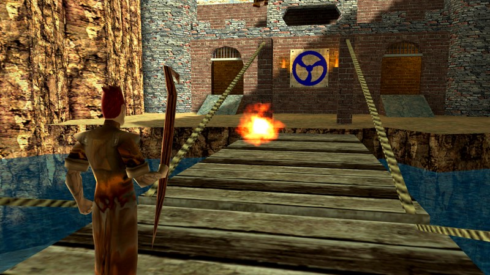 **Fireball** |
|---|---|
| 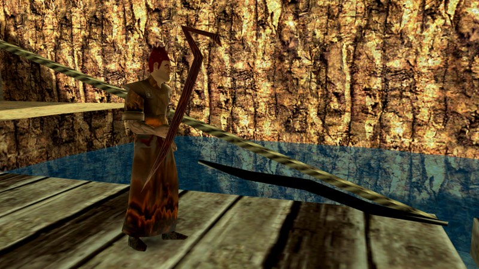 **Reality Fissure** |  |

**Satchel: Pyro Satchel.** Two arms of flame spiral outward to 5 m over two seconds, burning
everything they sweep through.

**Combos:** with a Necromancer → [Meteor](combo_spells.md#meteor); with a Fulgomancer →
[Ball Lightning](combo_spells.md#ball-lightning).

**Tips**
- *Set them on fire.* Your strength is keeping enemies alight with Flame Lick and Fireball.
  It's hard to aim while you're burning to death. Get in close, set them on fire and retreat
  while they burn.
- *Hold them off with your satchels.* The fire spiral blocks a corridor for a couple of
  seconds. Drop one when you're being chased, or throw one into a room full of defenders to
  move them off their positions.
- *Save Fissure for a crowd or a wall.* It costs nearly all your mana and leaves you standing
  still, but nothing within 3 m survives it.

---

## Cryomancer (ice)

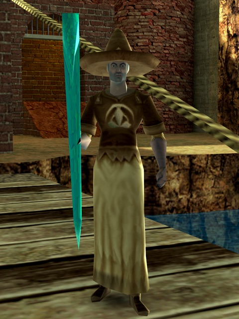

> *A master of ice and illusion, the Cryomancer is possibly the most versatile wizard of all.
> He slips unseen through the smallest portal, and, when it suits his purpose, completely
> disappears. No one is safe; for just when you think you're alone he slams you in the back
> with the crystal staff.*

**Health** 90 · **Speed** fast

| Slot | Spell | Mana | What it does |
|---|---|---|---|
| 1 | Crystal Staff | — | Melee swing, 30 damage. |
| 2 | Mind Missile | 10 | A heavier bolt than the magic missile: 30 damage, half the rate, and it shoves what it hits. |
| 3 | Ice Poke | 5 | A ring of six ice shards, 10 each, every one of them frosting what it hits. |
| 4 | Freeze Ray | 4, then 1/s | A beam you hold on someone: 5 damage four times a second, every pulse frosting them longer. |
| 5 | Invisibility | 8, then 2.5/s | Hold to fade out. Standing still you're completely invisible; at a full sprint you're half visible. Let go, or run out of mana, and you reappear. |

| 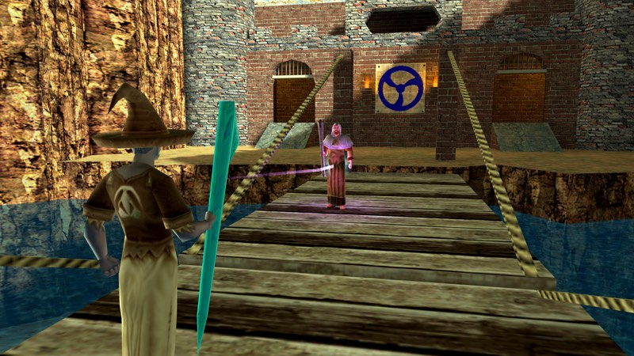 **Mind Missile** | 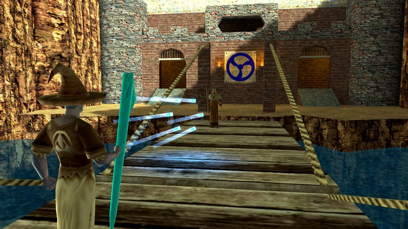 **Ice Poke** |
|---|---|
| 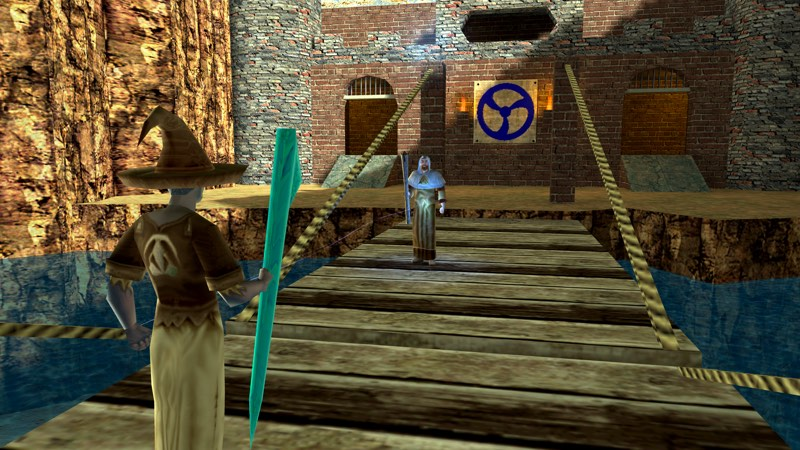 **Freeze Ray** | 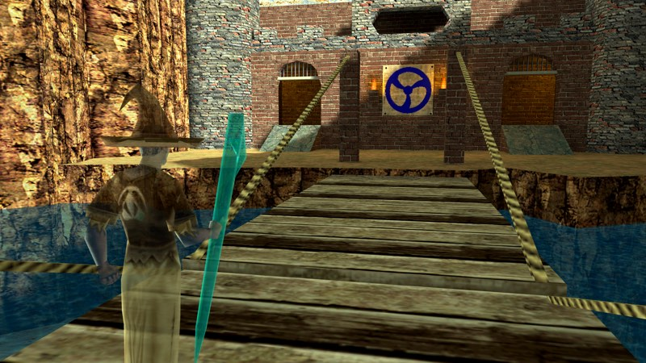 **Invisibility** |

**Satchel: Teleport Satchel.** It doesn't explode. When the fuse runs out, you're teleported to
wherever it landed. Throw it up a ledge, over a wall or into the enemy base, and follow it.

**Combos:** with a Phytomancer → [Giant Plant](combo_spells.md#giant-plant); with a
Fulgomancer → [Lightning Cloud](combo_spells.md#lightning-cloud).

**Tips**
- *Freeze them!* Your strength is frosting enemies with Ice Poke and the Freeze Ray. A frosted
  wizard skates around helplessly. Frost one on a ledge or a bridge and let them slide off.
- *Go invisible.* What your enemies can't see is harder for them to hit. Invisibility works
  best standing still: pick a corner, wait, and strike first.
- *Provide intelligence.* Waiting unseen in the enemy base for the perfect moment to grab the
  flag? Make yourself useful and tell your team where the defenders are, what they're playing
  and where their thornplants grow.

---

## Fulgomancer (lightning)

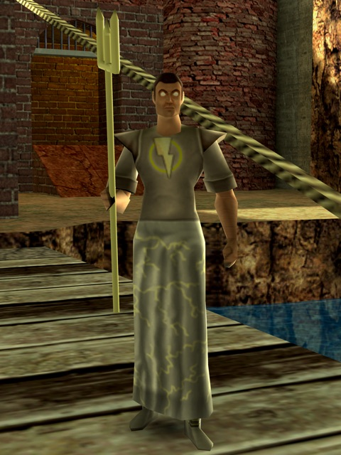

> *Bringer of the Thunderous Storm, the Fulgomancer commands the power of maelstroms,
> thunderheads, squalls, and hurricanes, though the power most fear is that of lightning.
> Any contesting the strike of a well-placed bolt often are found, struck down.*

**Health** 80 · **Speed** medium

| Slot | Spell | Mana | What it does |
|---|---|---|---|
| 1 | Trident Staff | — | Melee swing, 30 damage. |
| 2 | Lightning Bolt | 2 per zap | Hold to zap whatever you're aiming at, four times a second, for 10 a zap. Instant: no travel time, no dodging. |
| 3 | Spot Bolt | 5 | Hold to charge; a targeting dot follows your aim on the ground. Release to call a lightning strike down on the dot for up to 80, scaling with the charge (at least 1.5 seconds, full at 11). Hold past 16 seconds and it backfires on you for 40. **Secondary fire** zooms in for sniping. |

The Fulgomancer has no magic missile: Lightning Bolt does that job, and does it better at
range.

| 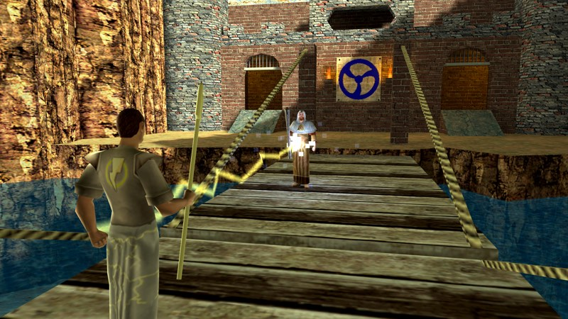 **Lightning Bolt** | 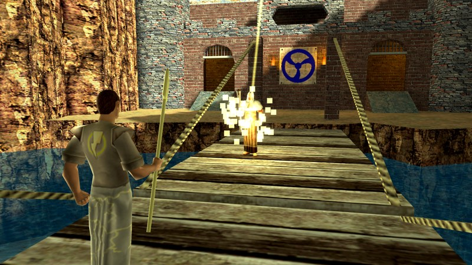 **Spot Bolt** |
|---|---|

**Satchel: Lightning Satchel.** Three lightning strikes on the spot, 0.4 seconds apart, each
for 40 to 75.

**Combos:** with a Pyromancer → [Ball Lightning](combo_spells.md#ball-lightning); with a
Cryomancer → [Lightning Cloud](combo_spells.md#lightning-cloud).

**Tips**
- *Snipe.* Zoom in with secondary fire and charge a Spot Bolt on a defender who's standing
  still. The strike comes down from the sky, so cover in front of them doesn't help.
- *Mind the clock.* An overcharged Spot Bolt hurts you, not them. When it starts to crackle,
  you have four seconds left to let go.

---

## Geomancer (earth)

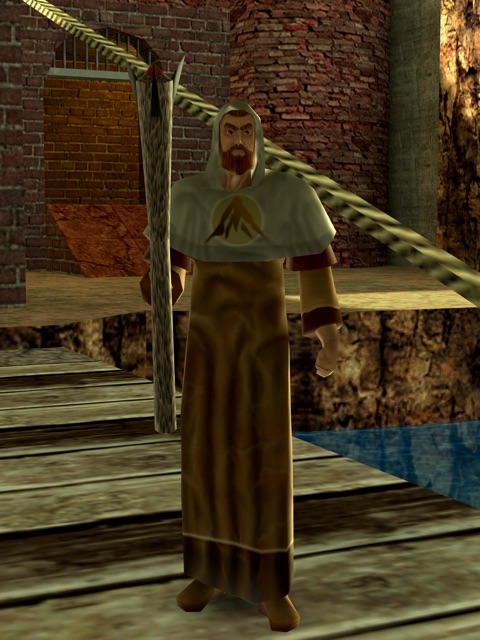

> *Conjurer of the Unmoving Earth, the Geomancer calls forth the animals of the realm, and
> even the stone of the realms themself, to fell his opponents. Within everything, birds,
> bears, and rocks, exists a spirit, and the Geomancer seeks to unify with them, even melding
> to become one.*

**Health** 100 · **Speed** slow

| Slot | Spell | Mana | What it does |
|---|---|---|---|
| 1 | Earthen Staff | — | Melee swing, 30 damage. |
| 2 | Rolling Stone | 5 | A boulder that bounces along the ground for two seconds and hits for 80. |
| 3 | Pebble Blast | 10 | A shotgun of eight pebbles, 6 each. Brutal up close. |
| 4 | Art of Falconry | 5 | A falcon that flies off, finds the nearest enemy within 13 m and dives at them for 20. |
| 5 | Bear Form | 20 | Turns you into a bear: 200 health, a bite for 150, and slower than anything else on the field. Costs 5 mana every 2.5 seconds to stay a bear, and you change back when the mana runs out or you cast it again. |

| 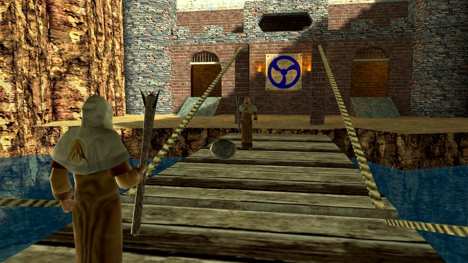 **Rolling Stone** | 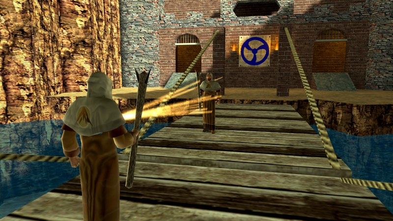 **Pebble Blast** |
|---|---|
| 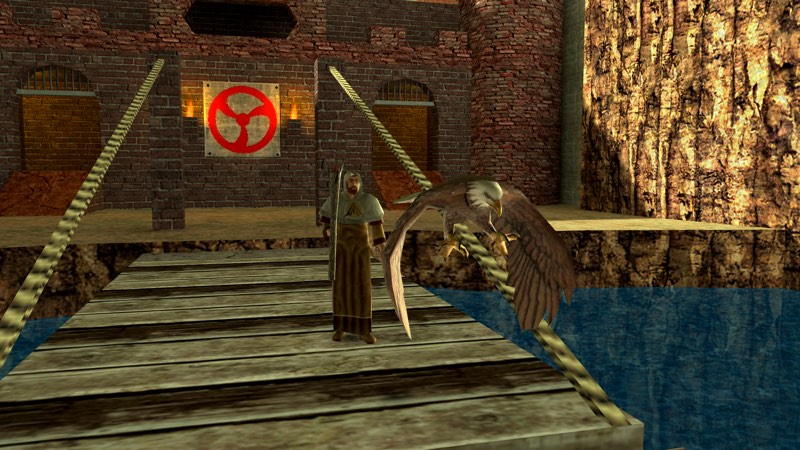 **Art of Falconry** | 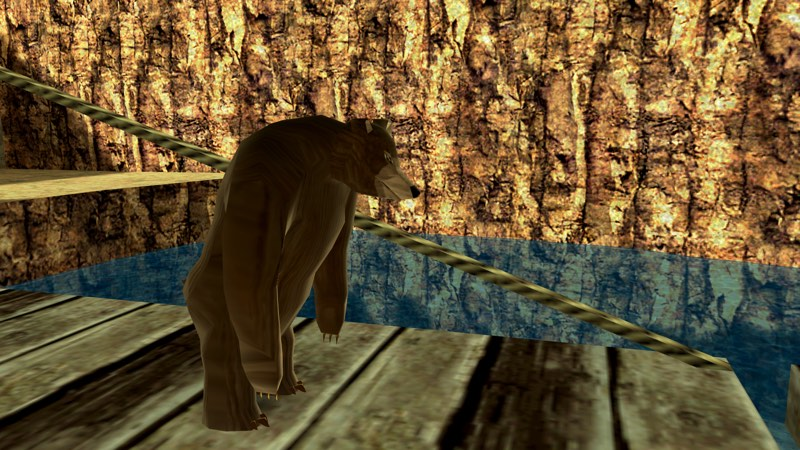 **Bear Form** |

**Satchel: Earthquake Satchel.** Three shockwaves, half a second apart, each for 40 to 75.

**Combos:** with an Aeromancer → [Tornado](combo_spells.md#tornado); with a Sanomancer →
[Wally the Wombat](combo_spells.md#wally-the-wombat).

**Tips**
- *Defend.* You're one of the slowest classes, and you'll be picked off before you reach the
  enemy base. On defence you're one of the strongest: keep throwing stones and falcons at
  anyone coming in.
- *Stand in doorways and narrow halls.* Aeromancers hate you. Make them come through you,
  and watch out for their Updraft and wind satchels.
- *Be a bear!* The bear is a big, slow bodyguard, good for escorting the flag carrier or
  holding a corridor. Kill something, grab its mana and stay a bear longer.

---

## Aeromancer (wind)

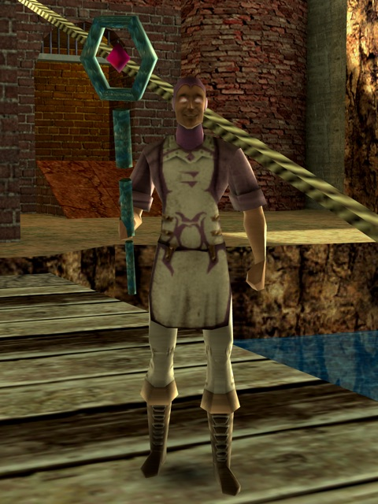

> *Walker upon the Four Winds, the Aeromancer is that which brings the storm, and causes
> devastation to the countryside far and wide. There is little haven against the gales, and
> it soon throws about those caught in its fury.*

**Health** 80 · **Speed** fastest

| Slot | Spell | Mana | What it does |
|---|---|---|---|
| 1 | Wind Staff | — | Melee swing, 30 damage. |
| 2 | Mind Missile | 10 | A heavier bolt than the magic missile: 30 damage, half the rate, and it shoves what it hits. |
| 3 | Updraft | 5 | An instant gust where you aim that throws everyone within 3 m upward and away, for 5 damage. Including you: aim at your feet to launch yourself. |
| 4 | Levitate | 5, then 2/s | Hold to float: a lift off the ground, a tenth of normal gravity and full air steering. Let go to drop. |
| 5 | Clone | 15 | At a run, splits you in two: you veer 45° one way while a decoy of you peels off 45° the other. **Secondary fire** mirrors which way each of you goes. You have to be on the ground and moving fast. |

| 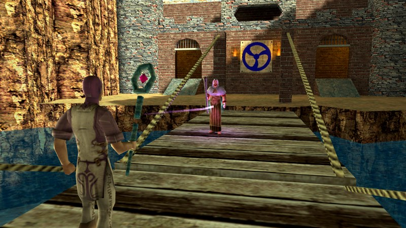 **Mind Missile** | 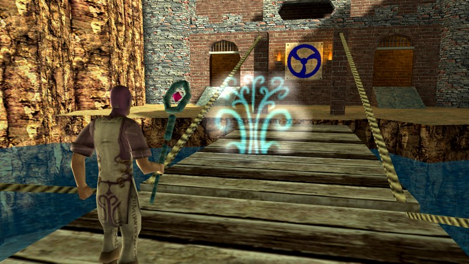 **Updraft** |
|---|---|

**Satchel: Cyclone Satchel.** A blast that throws everyone near it, you included, for 10 to
50. Land one at your own feet for a rocket jump.

**Combos:** with a Geomancer → [Tornado](combo_spells.md#tornado); with a Necromancer →
[Raise Dead](combo_spells.md#raise-dead).

**Tips**
- *Go over, not through.* Updraft, Levitate and your satchel all get you up onto ledges and
  over defenders that slower classes have to fight past.
- *Break their footing.* An Updraft under a defender standing on a ledge or a bridge does
  more than any missile.
- *Clone to escape.* A pursuer has a coin flip to guess which of you is real.

---

## Phytomancer (nature)

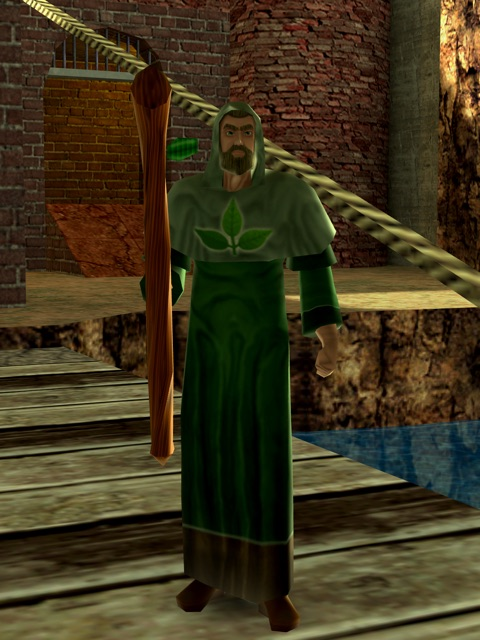

> *Watcher over the Verdant Plains, the Phytomancer controls the forces of nature, whether
> fern, bush, or oak, raising the forests to defend themself from the imperial onslaught.
> The Phytomancer's focus towards protection of plants may be misconstrued as weakness; the
> wrath of the forest is one few tempt.*

**Health** 90 · **Speed** fast

| Slot | Spell | Mana | What it does |
|---|---|---|---|
| 1 | Nature Staff | — | Melee swing, 30 damage. |
| 2 | Magic Missile | 5 | A straight bolt for 15. Hold to keep firing. |
| 3 | Thornblast | 5 | A shotgun of four thorns, 10 each. |
| 4 | Beanstalk | 5 per segment | Hold where you want it to grow and a climbable beanstalk rises out of the ground, a segment at a time. Instant ladder! It has 80 health and slowly heals. |
| 5 | Thornplant | 75 | Grows a thornplant turret in front of you that shoots the enemies it sees. You can have one at a time. Cast it while looking at your plant to fertilize it: 75 mana takes it up a level and back to full health, and with less mana (or at level 3) it heals the plant by one point per mana. |

**Thornplant levels**

| Level | Health | Damage | Fires every | Range |
|---|---|---|---|---|
| 1 | 100 | 13 | 0.5 s | 13 m |
| 2 | 200 | 15 | 0.375 s | 19 m |
| 3 | 300 | 20 + poison spores | 0.25 s | 22 m |

| 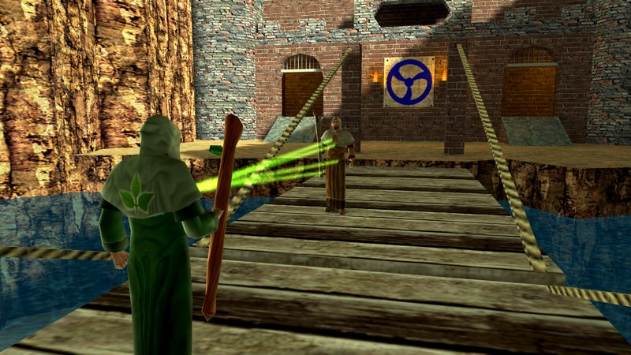 **Thornblast** | 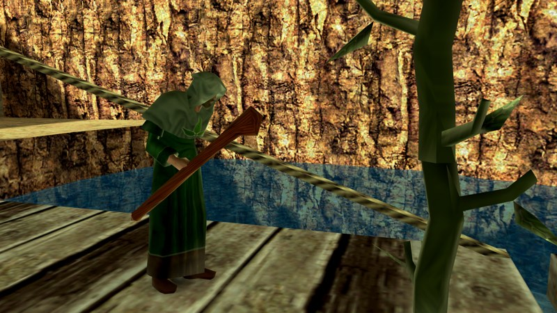 **Beanstalk** |
|---|---|
| 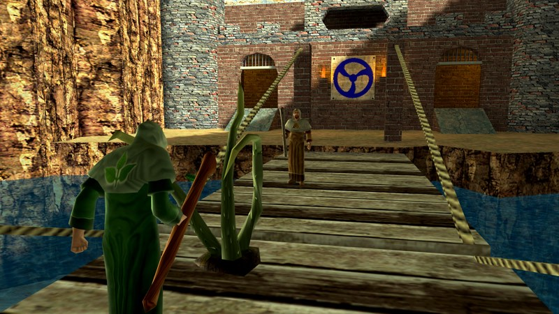 **Thornplant** |  |

**Satchel: Cocklebur Satchel.** A burst for 10 to 50 that leaves three cockleburs on the
ground. They sit as traps, and an enemy who walks over one gets it stuck to them, slowing them
down and eating at their health.

**Combos:** with a Cryomancer → [Giant Plant](combo_spells.md#giant-plant); with a
Sanomancer → [Spirit Wizard](combo_spells.md#spirit-wizard).

**Tips**
- *Get mana.* Everything you do runs on it. Grab packs whenever you pass them.
- *Build a thornplant.* It's your most useful contribution to the team. Placement matters:
  don't worry if the first few get destroyed. Find a spot the enemy has trouble reaching and
  try again.
- *Fertilize it.* A level 3 plant fires four times a second and poisons what it hits.
  Keep it topped up: a few spare mana heals it.
- *Build a beanstalk.* Your team will be eternally grateful for a way up. It's fragile, so
  keep it protected.

---

## Sanomancer (life)

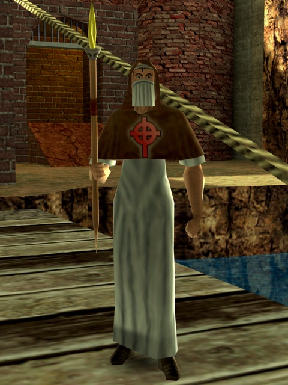

> *Master over the Divine Arts, the Sanomancer is trained in the judgement of the world, lending
> aid in the form of mending to allies, and striking those that would oppose their crusade.
> Few dispute the unrivalled aid a Sanomancer brings to the battlegrounds of Arathas.*

**Health** 75 · **Speed** fastest

| Slot | Spell | Mana | What it does |
|---|---|---|---|
| 1 | Staff of Healing | — | Melee swing, 30 damage. |
| 2 | Dual Magic Missile | 5 | Magic missiles from alternating hands, twice the rate of the single one. |
| 3 | Life Ray | 2, then 1/s | A beam: 10 damage four times a second on an enemy, or 5 healing on a teammate. It can overheal a teammate to 150%. |
| 4 | Force Blast | 5 | A shockwave around you that hurls enemies away and gives you a kick in the direction you're moving. |
| 5 | Sacrifice | 10 | Four seconds after you cast it, you go up in a ring of white light. Every enemy within 3 m is blinded and left at half health. You die. |

| 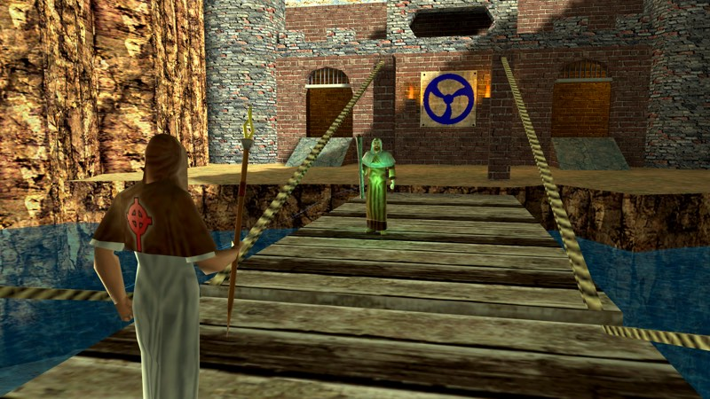 **Life Ray** | 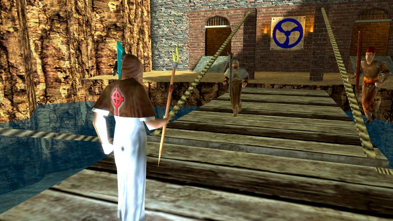 **Force Blast** |
|---|---|

**Satchel: Heal-Hurt Satchel.** One burst within 3 m: 10 to 50 healing for every teammate,
10 to 50 damage for every enemy.

**Combos:** with a Phytomancer → [Spirit Wizard](combo_spells.md#spirit-wizard); with a
Geomancer → [Wally the Wombat](combo_spells.md#wally-the-wombat).

**Tips**
- *Heal, then fight.* The Life Ray cures poison, burning and frost along with the damage.
  Teammates will call for you; go to them.
- *Stick with the slow ones.* A Geomancer or Necromancer holding a door lasts much longer
  with you behind them.
- *Force Blast for space.* It throws attackers off you and you away from them in the same
  cast.

---

## Necromancer (death)

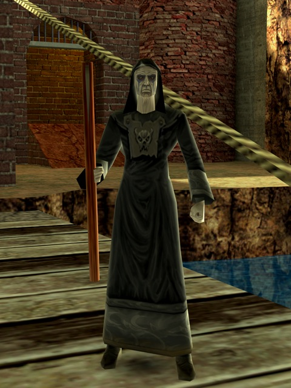

> *Lord over all that is Death, the Necromancer brings the souls of the dead back, to undeath,
> for a corpse has no fear or sense of pain, and thus makes the perfect soldier. Necromancers
> tend to find new means to sustain themselves, such as siphoning the life of wayward
> travelers.*

**Health** 120 · **Speed** slow

| Slot | Spell | Mana | What it does |
|---|---|---|---|
| 1 | Scythe Staff | — | Melee swing, 30 damage. |
| 2 | Poison Missile | 5 | The magic missile, green: 15 damage that poisons. |
| 3 | Death Ray | 2, then 1/s | A beam: 10 damage four times a second, half of which heals you. |
| 4 | Seeking Skull | 5 | A flying skull that hunts down the nearest enemy within 12 m and bursts on them for 15. |
| 5 | Grim Feast | 25 | Devour a corpse within 2 m: you're healed by a full bar of health (overhealing up to 150%) and cured of everything. The body is gone afterwards. |

| 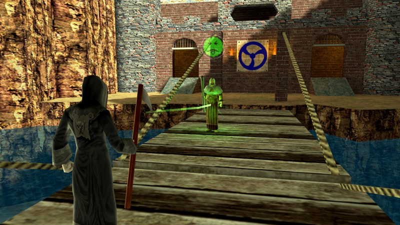 **Poison Missile** | 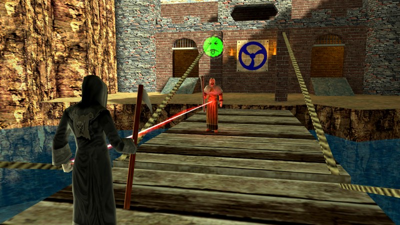 **Death Ray** |
|---|---|
| 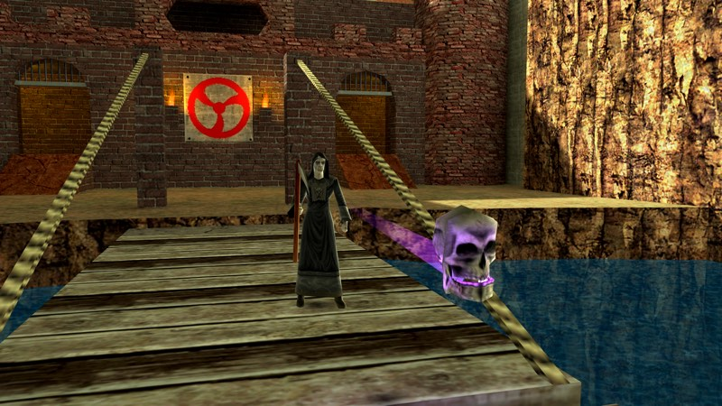 **Seeking Skull** | 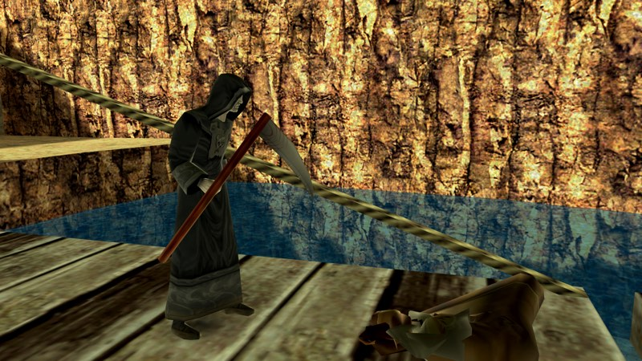 **Grim Feast** |

**Satchel: Satchel of Decay.** A burst for 10 to 50 that poisons everyone it hits.

**Combos:** with a Pyromancer → [Meteor](combo_spells.md#meteor); with an Aeromancer →
[Raise Dead](combo_spells.md#raise-dead).

**Tips**
- *Infect your enemies.* Poison doesn't wear off. It keeps ticking until they find a healer
  or a health pack.
- *Heal yourself.* Between the Death Ray's drain and Grim Feast, you can keep fighting long
  after the others have gone looking for health.
- *Mind your corpses.* A body you feast on is one a [Raise Dead](combo_spells.md#raise-dead)
  can't use.

---

## Archmage

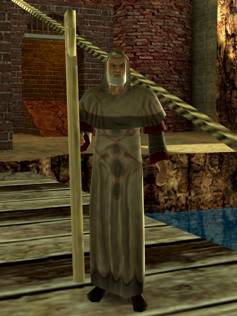

> *This special character appears only in certain situations.*

The Archmage is the wizard everyone else is fighting over: the hunted on maps such as ww_hunt.
Only maps that ask for one let you play an Archmage; you won't find it in the class menu
anywhere else.

**Health** 60 · **Speed** slowest

| Slot | Spell | Mana | What it does |
|---|---|---|---|
| 1 | Crook Staff | — | Melee swing, 30 damage. |
| 2 | Magic Missile | 5 | A straight bolt for 15. Hold to keep firing. |
| 3 | Comet | 45 | Calls a comet onto the nearest enemy you can see in front of you, out to 100 m. It homes in and bursts for 200 within 5 m. |

| 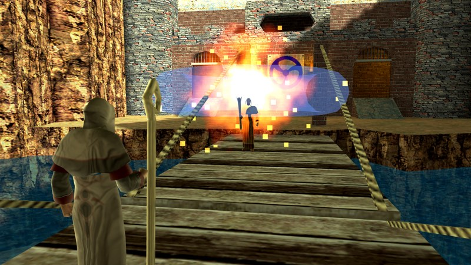 **Comet** |  |
|---|---|

**Satchel: Health Satchel.** It goes off almost the moment you let go, healing you for 60.

**Combos:** none.
